# How to Run Jev Inside an Open Agent Harness

AI agents run in a loop where a model decides what to do, calls a tool, processes the result, and continues until the task is complete.

Two capabilities make that loop possible. Tool calling lets a model invoke tools, and structured outputs let it return data in a predictable format. They make it easier for agents to interact with software and connect models to apps.

The harness brings these pieces together. It manages the agent's execution loop, including which tools are available, how their results are handled, what context the model receives, and what happens next.

How the harness manages these steps affects cost. More context and more model calls can make an agent expensive to run.

Consider a client follow-up workflow that needs to match client requests against GitHub issues. The agent needs to decide which issue matches the request. An LLM can make those decisions, but it generates unnecessary text for every match.

These are decision problems. The model needs to choose from a fixed set of options and estimate how confident it is in its choice rather than generating text.

That's where Jev, a System One decision model from TypeSafe AI, comes in. TypeSafe AI reports that Jev runs 40× to 200× faster than LLMs on decision-shaped agentic workflows.

In this article, we'll look at how Jev works, where it fits into an agent harness, and how to run it inside an open-source harness.

## Where the tokens go

Consider an account team at a software company. It logs every client request, from features to bugs, in Notion, and engineering tracks the work in GitHub.

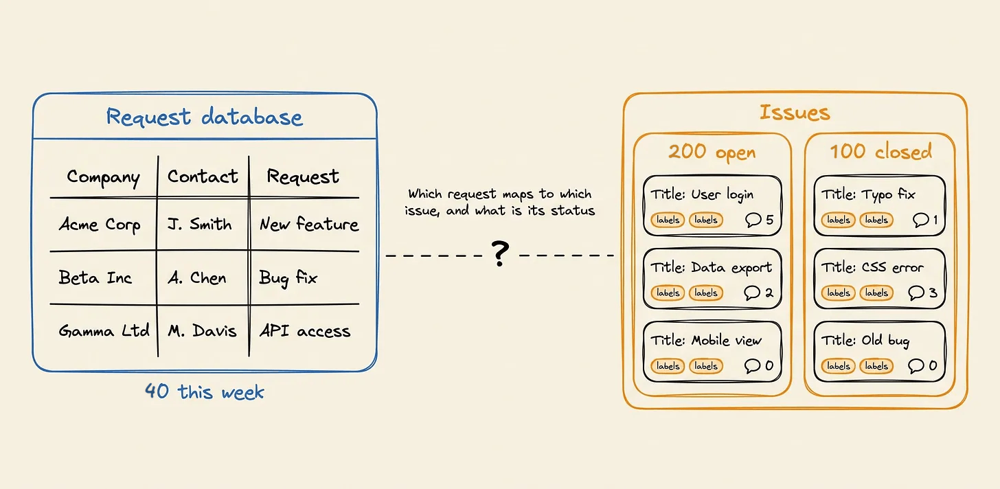

The company log has 40 requests. GitHub has 300 issues (200 open and 100 closed), each with a title, discussions, labels, etc. At roughly 230 tokens/issue, that is about 69,000 tokens.

Matching each request to the right issues is where the tokens go:

- 40 requests against 300 issues is 12,000 possible pairs.
- Keywords don't settle them, because clients and engineers rarely describe a problem in the same words.
- Prompt caching makes rereading the backlog cheaper, but the model still processes all of it.
- A cheaper model lowers the price per token but gives no reliability on how confident each match is.

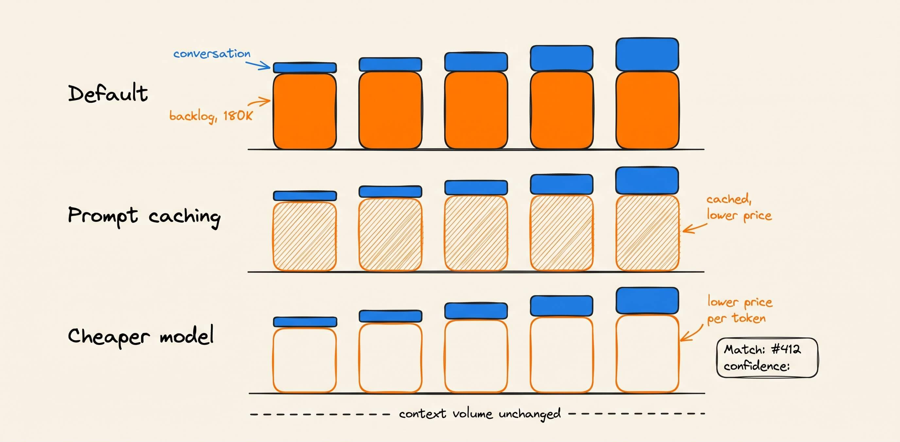

That last gap is the risky one. A confident wrong match can lead to telling a client that engineers are fixing their bug while the team is working on something else.

## Three levers on agent cost

There are three ways to reduce the cost of a run:

1. **Context.** How much information the model carries from one call to the next.
2. **Calls.** How often the harness goes back to the model.
3. **Assignment.** Which model is responsible for each decision?

The harness controls the first two. The third is model assignment, where Jev handles the decisions, so let's look at how it works.

## How Jev makes decisions

Many agent tasks don't need generated text. They need a choice from a fixed set of options, like classifying a category or scoring priority. A decision model takes the options from the app and returns a structured choice that software can use.

Jev, from TypeSafe AI, is designed for this kind of task. TypeSafe calls it its first ["System One" model](https://typesafe.ai/blog/introducing-system-one-models-and-jev). For a deeper look at how Jev works, check out [this post](https://x.com/akshay_pachaar/status/2101037514945597645?s=20).

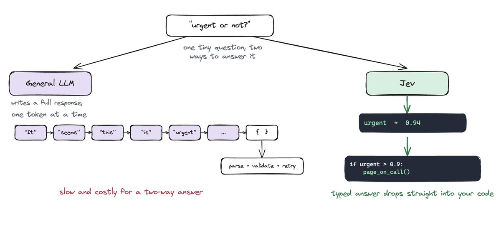

Jev takes a state and one or more typed questions, then returns structured answers:

- **Choice** picks one option from a set you define.
- **Score** places the state on an ordered set of levels.
- **Noul** returns the probability that a yes-or-no statement is true.

Here, the state is the customer request and its shortlisted issues. The choice question asks which issue matches, with "none" as an option:

```json
{
  "type": "choice",
  "choice": "#212",
  "confidence": 0.88,
  "probabilities": {
    "#212": 0.90,
    "#147": 0.06,
    "none": 0.04
  }
}
```

TypeSafe describes Jev's confidence as calibrated. Across predictions, answers given 0.88 confidence should be right about 88% of the time. If that holds for our workflow, confidence can decide which matches need review.

A request can include other questions too, such as the customer's urgency. Jev answers them in parallel, so they add a few tokens rather than another call.

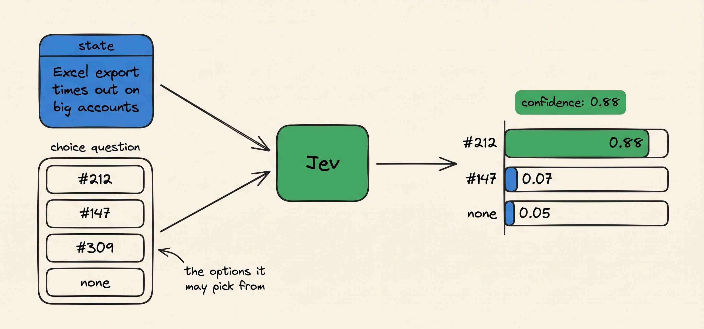

Jev charges $0.042 per million input tokens and nothing for output. Each request is about 900 tokens, so all 40 come to about 36,000 tokens, well under one cent.

Two limitations shape how we use Jev in this workflow:

- **Jev only chooses among the options it receives.** It can return "none", but it cannot create a new issue.
- **The input is bounded.** The state and its longest question must fit in 32,000 tokens, with at most 255 options. The 69,000-token backlog will not fit.

So we will first shortlist the top 10 issues, Jev will choose among them, and a generation model or LLM will handle the rest, all inside an open agent harness.

## What to look for in an agent harness

A harness manages everything around the model, including calling tools, handling their results, managing context, and deciding what happens next.

For our weekly client follow-up workflow, it also needs to handle a few practical requirements:

- start automatically every week
- recover if the server restarts
- pause for approval before writing anything
- keep each manager's session isolated

Many agent harnesses support these features. The difference is how efficiently they manage context and how often they call the model. Both affect the cost.

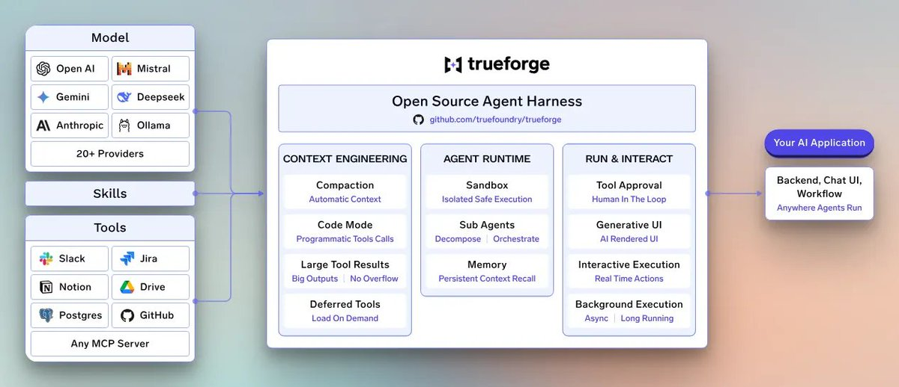

[TrueForge](https://github.com/truefoundry/trueforge) is an open-source agent harness from TrueFoundry. It provides one way to handle these tasks while offering several mechanisms to limit unnecessary context and model calls.

TrueForge aims to keep agents efficient without driving up costs.

On DevRev's Enterprise Bench, TrueForge, Claude Managed Agents, and deep agents solved about the same number of tasks. TrueForge got there on 2.7x fewer tokens than Claude Managed Agents and under a quarter of deep agents' tokens.

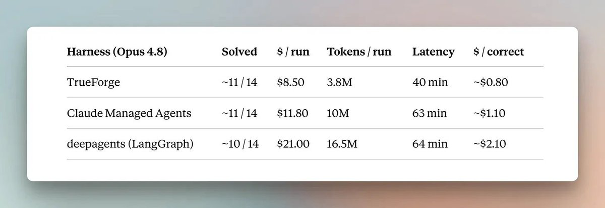

Four mechanisms reduce the context used per turn and the number of model calls per run.

### Deferred tool loading

TrueForge does not load every MCP tool definition at the start. It begins with each server's name and description, then fetches details when needed:

- `list_tools` returns the tool names on a server
- `get_tool_info` returns one tool's description and input-output schema
- `get_tool_output_schema` returns the output shape alone, so scripts do not guess keys
- `call_tool` runs a tool by name

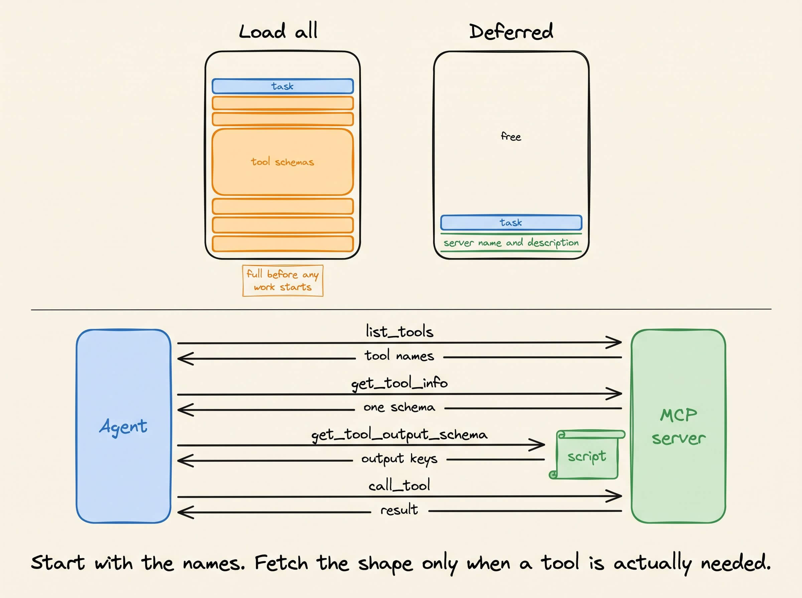

### Offloading

When a tool response is too large to fit in context, TrueForge writes it to a file in the sandbox. The conversation keeps a short preview and the file path. If several responses overflow, it offloads the largest first.

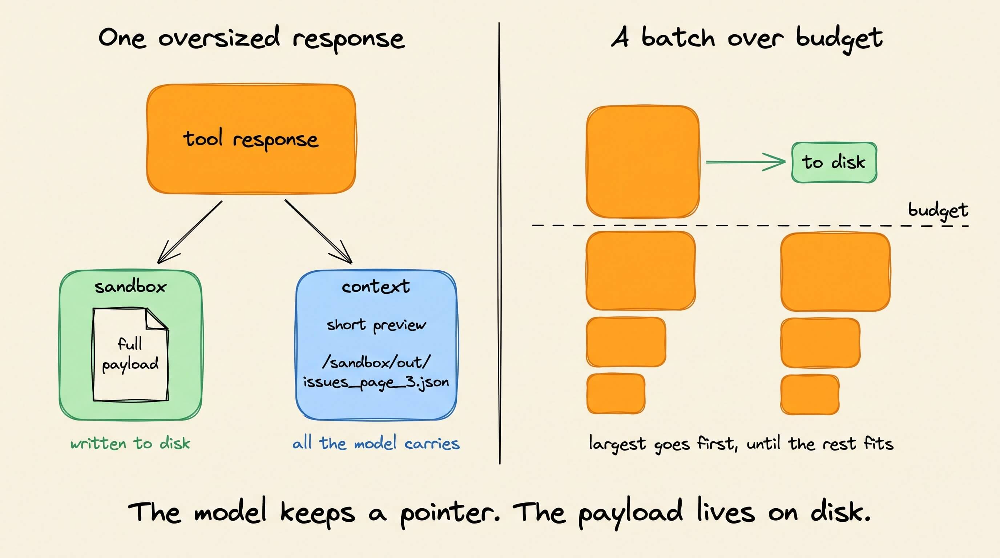

### Code Mode

In Code Mode, the agent writes a script to call tools and process their results. Intermediate data stays in the script instead of entering the conversation, which limits context growth and can reduce model calls.

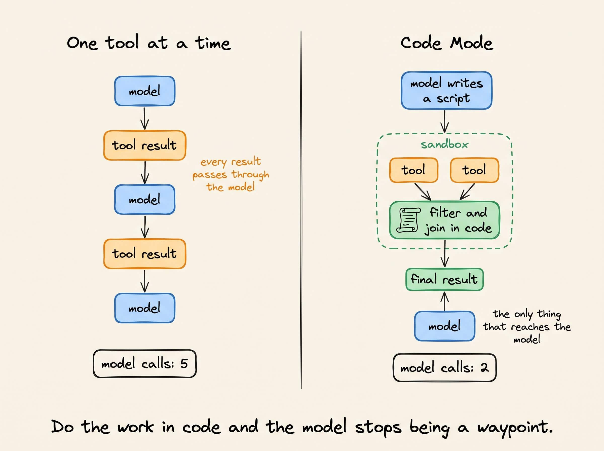

### Subagents

A subagent handles a focused task in its own context and returns a summary. This keeps the main context smaller, but the generation model still spends tokens reading every record assigned to the subagent.

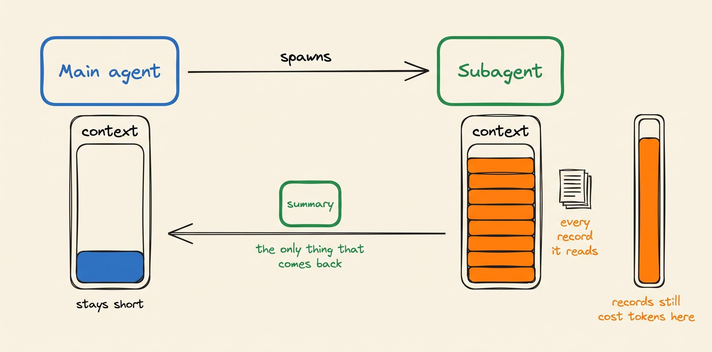

Some other details matter when a workflow handles customer data:

- **It runs where you run it.** A managed harness runs in the vendor's infrastructure, and so may your data. TrueForge is MIT-licensed and runs in your own environment.
- **It is already in production** as the copilot inside TrueFoundry's AI Gateway, and NetApp and Automatiq are building agents on it.

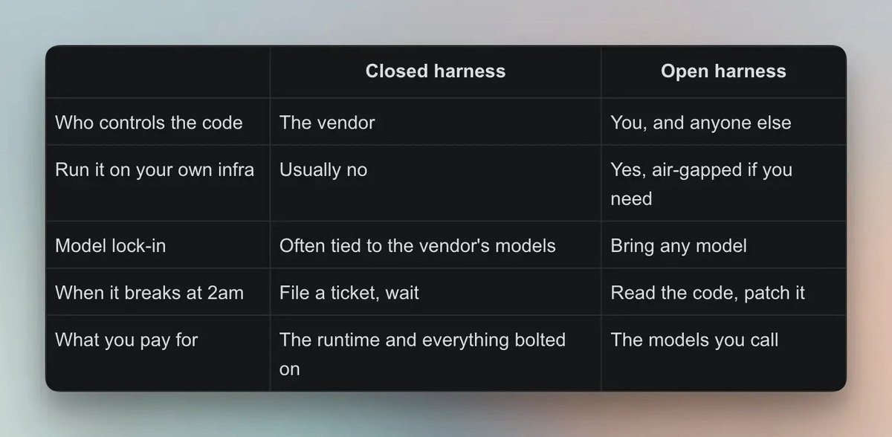

Even with those savings, a generation model still makes the matching decision by default. It is a model built to write text, yet the output needed here is just a choice among candidates. This is where model assignment matters.

## How to run Jev inside TrueForge

The weekly run has three steps:

1. **Find candidates.** A script ranks issues by shared words to keep the top ten. It misses some semantic matches but shrinks 300 issues to a set Jev can evaluate.
2. **Pick the match.** Jev receives each request with its candidates and chooses one issue or "none".
3. **Generate and review.** The generation model drafts a new GitHub issue when Jev returns "none" and reviews matches below the confidence threshold.

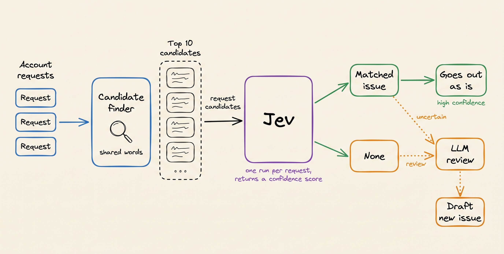

Once Jev selects an issue, the script maps its fields to a status the account team can act on:

- **In progress:** open, with an assignee or an "in progress" label
- **Tracked, not started:** open, with neither
- **Fixed or declined:** closed, depending on how it was closed

The workflow sends all 40 requests in one batched call. Scripts retrieve and process the data, Jev matches the requests, and the generation model drafts new issues and reviews uncertain matches.

Generated scripts create a credential risk. If the Notion, GitHub, and Jev keys are available inside the sandbox, a script can access them. Text retrieved from an issue could also influence what that script does.

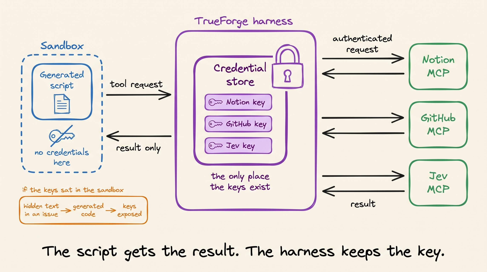

TrueForge adds two guards:

- **Credentials stay outside the sandbox.** Tool requests go through the harness, which applies the credentials itself.
- **Writes need approval.** Nothing changes in Notion or GitHub until the account team approves the proposed links and new issues.

## Deciding which matches to trust

The workflow accepts Jev matches above the confidence threshold. Lower-confidence answers, including an uncertain "none", go back to the generation model with the shortlist and probabilities for review.

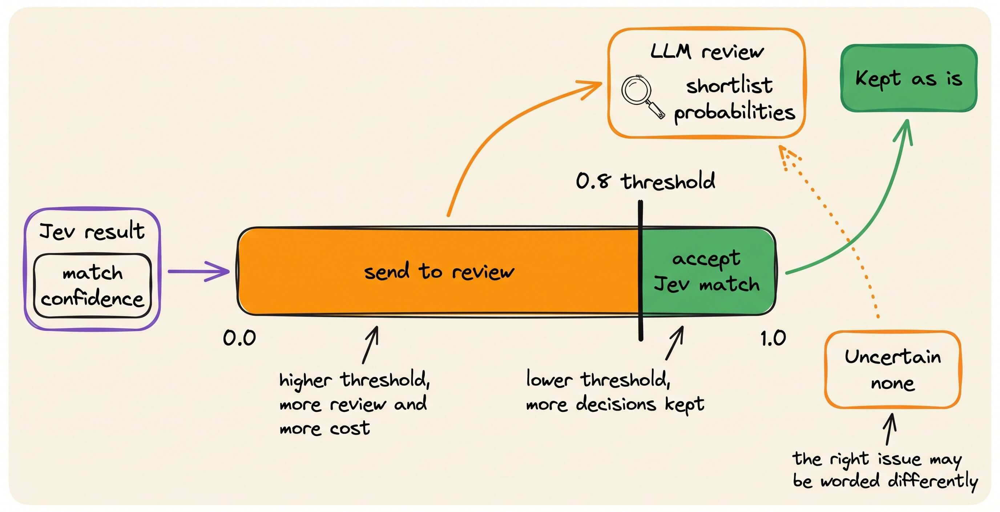

A higher threshold sends more matches to review. That costs more, but fewer wrong matches pass automatically. A lower threshold saves on review and accepts more risk.

There is a limit to this. Jev's confidence only covers the candidates it sees. If shortlisting dropped the correct issue, Jev can still confidently pick the closest wrong one.

The results show why that matters.

## Results

We tested 40 requests with two versions of the same agent, both on Claude Opus 5.5 with default settings:

**With Jev** (`weekly-client-follow-up`): the agent shortlists 10 issues per request, and Jev picks a match. Anything below 80% confidence, or 90% for closed issues, goes to the generation model for review.

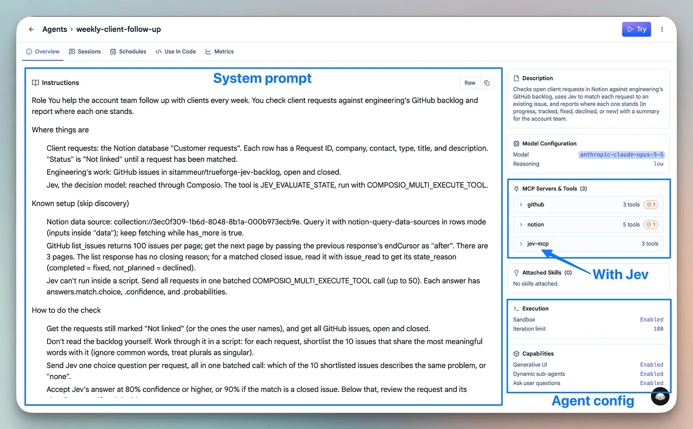

**Without Jev** (`weekly-client-follow-up-no-jev`): the agent uses the same instructions and shortlisting, with no Jev connector. The generation model reads each shortlist and picks the match.

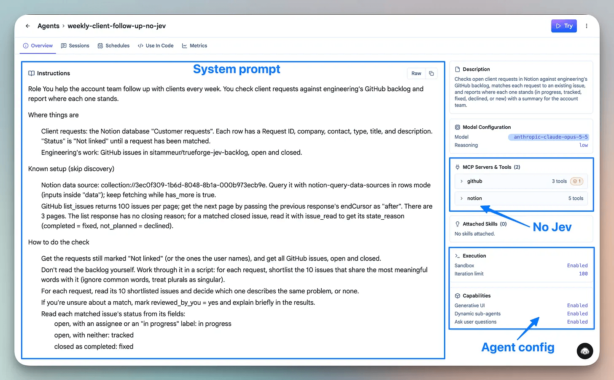

The test set covers straightforward matches, near-duplicates, regressions, feature requests, and requests with no matching issue. Each request has a known answer, so we scored both runs against the same ground truth.

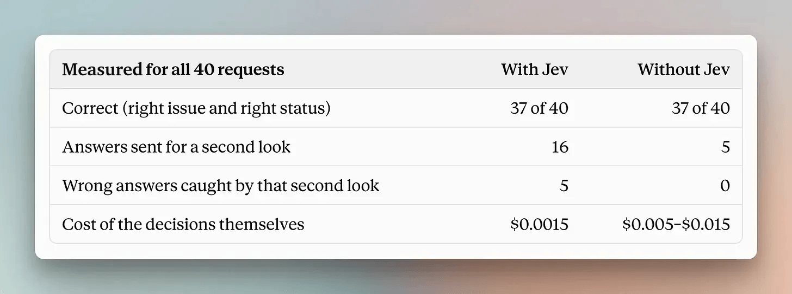

Both setups got 37 of 40 right. The difference was what happened when a match looked uncertain:

- With Jev, 16 answers went for a second look, and review caught 5 wrong ones
- Without Jev, 5 answers went for a second look, and review caught none

REQ-004 shows the failure mode. The customer says their search "keeps spinning and then gives up" now that their whole company uses the product. GitHub has an issue about search timing out, but the cause is different.

- Without Jev, the generation model picked that issue, and the summary would have listed the request as already tracked
- With Jev, the top candidate scored only 0.40, so it went to review, which correctly marked it as new

Not every error reached review. In REQ-001, one of Jev's three misses, Jev gave the wrong issue its highest confidence, so the answer went straight through.

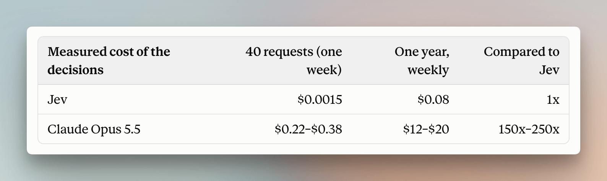

Decision cost grows roughly in proportion to the number of requests. The table compares Jev with Claude Opus 5.5 making the same 40 decisions from the same shortlists.

At $4 per million input tokens and $20 per million output tokens, Opus would cost an estimated 150 to 250 times as much as Jev. With extended thinking on, Opus bills thinking tokens as output, so the upper end is more likely.

The workflow runs on an open agent harness, so you can reproduce the test or point it at your own backlog.

## Run it yourself

TrueForge runs locally as a single process on SQLite. You need Node 22.13 or newer.

```bash
npx @truefoundry/trueforge
```

Open <http://localhost:8790> and configure the runtime in Settings.

<video src="https://github.com/user-attachments/assets/3bb26c33-43cd-4d7b-8e70-71b625b5d8e7" controls width="100%"></video>

> [!WARNING]
> Local mode has no login, so use it only on a machine you control. For multiple users, run hosted mode on Postgres and Redis, deployed through Docker Compose or Helm.

1. Add your model provider under **Settings → Models**. This demo uses Claude Opus as the generation model.

   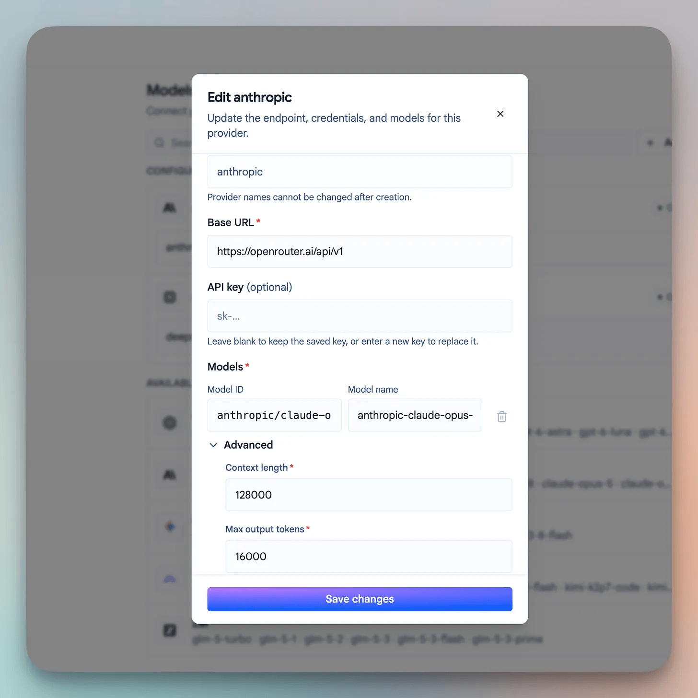

2. Connect the GitHub, Notion, and Jev MCP servers under **Connectors**, and add a Daytona key under **Sandbox providers** for code execution and file offloading.

   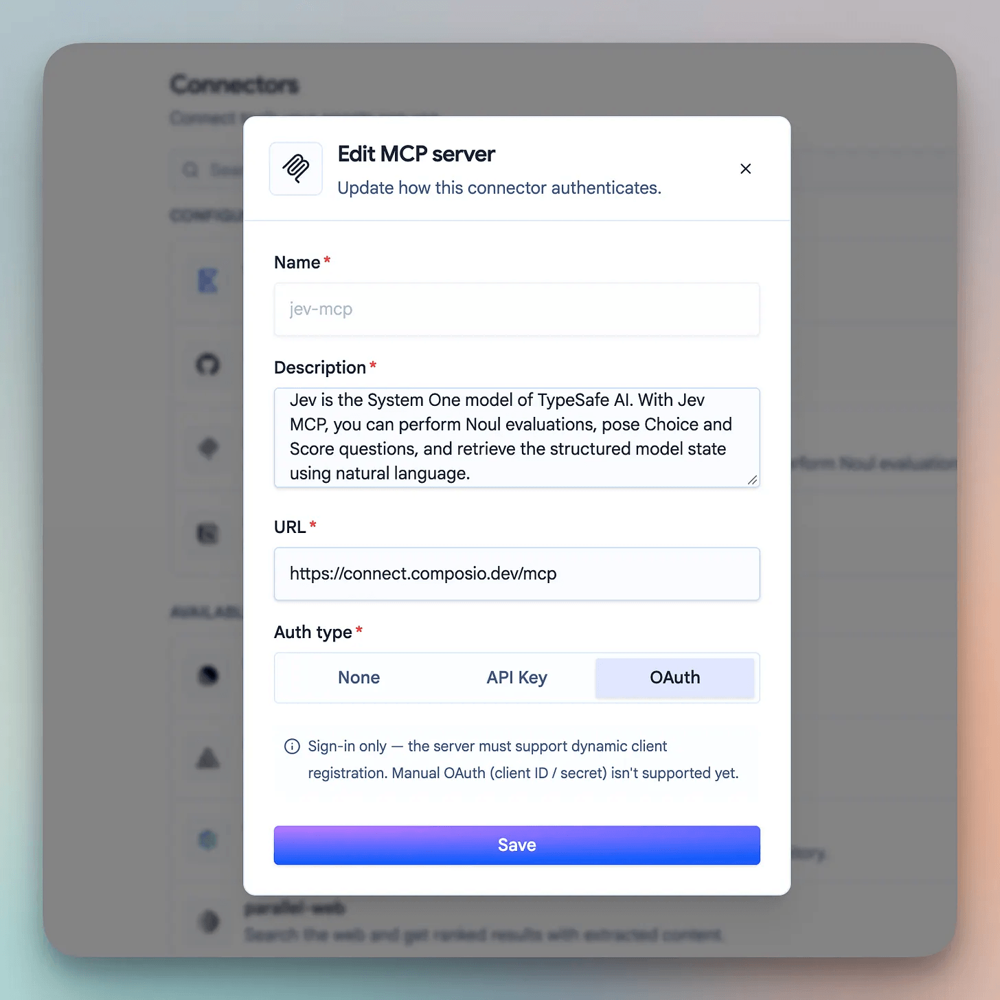

3. Create an agent with the generation model, the three connectors, and the workflow instructions, then save it to the library.

4. Schedule the agent for every Friday morning, with the account team's message as its task.

   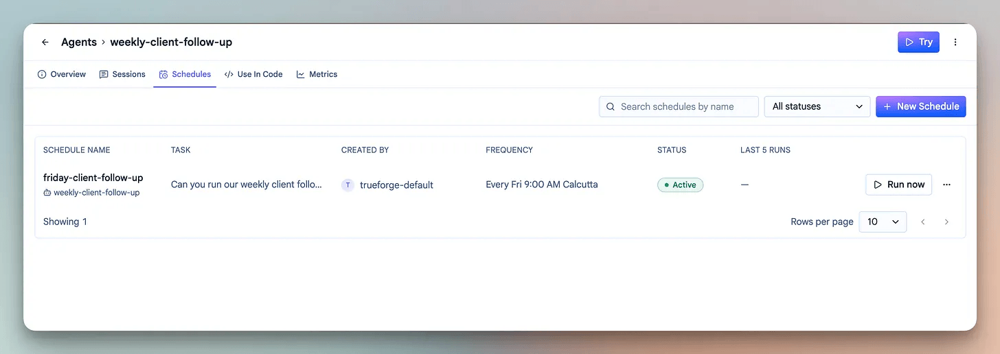

The message:

```text
Can you run our weekly client follow-up?
Check which of our open client requests engineering is already tracking, and where each one stands.
Draft issues for anything new, and give me a summary I can share with the team.
```

Each run does the matching and leaves proposed links and new issues waiting for approval when the team starts work.

The chat UI is the quickest way to try it. For deeper configuration, use the agent specification, or embed the agent in your own app through the API and SDK.

## What's in it for you

In this workflow, TrueForge cuts context and model calls, and Jev makes each match with a confidence score. The generation model drafts new issues and reviews uncertain matches, and the account lead approves every change.

The main takeaways are straightforward:

- **The harness affects cost.** It controls how much context reaches the model and how often the agent calls it.
- **Model assignment is part of the architecture.** A generation model does not need to make every bounded decision.
- **Confidence can control review.** A calibrated score lets the harness accept confident decisions and send uncertain ones back to the generation model.

The same approach fits any workflow that makes repeated decisions over records, such as inbox triage, ticket tagging, CRM classification, and transaction review.

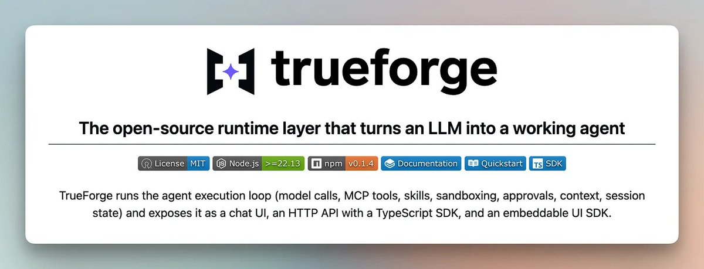

- Check out [TrueForge (MIT-licensed) on GitHub](https://github.com/truefoundry/trueforge) →
- Explore [TypeSafe documentation on Jev](https://docs.typesafe.ai/) →

👉 Over to you: when your agent has to make a judgment on every row, which model does it use?

---

## 📬 Stay Updated with Our Newsletter!

**Get a FREE Data Science eBook** 📖 with 150+ essential lessons in Data Science when you subscribe to our newsletter! Stay in the loop with the latest tutorials, insights, and exclusive resources. [Subscribe now!](https://join.dailydoseofds.com)
[](https://join.dailydoseofds.com)

---

## Contribution

Contributions are welcome! Please fork the repository and submit a pull request with your improvements.
